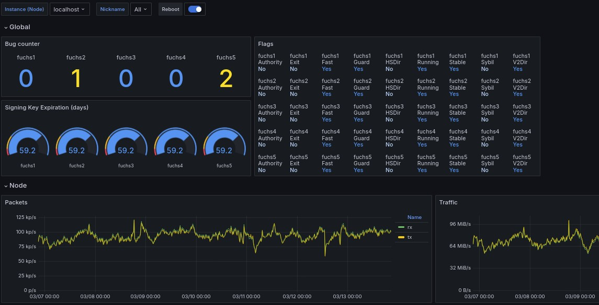

[](https://github.com/vshymanskyy/StandWithUkraine/blob/main/docs/README.md)

# Tor Grafana Dashboards

Few dashboards I do use for Tor, Snowflake and other nodes.



## Scraping Tor metrics

An Ansible code snippet to configure a metrics port is given [here](https://github.com/toralf/tor-relays/?tab=readme-ov-file#metrics).

The Prometheus config for several dashboards leverages to know a _nickname_ for a given address.
In the example below it is set to _address_ (== the hostname):

```yaml
- job_name: "Tor-Relay"
  metrics_path: "/metrics-relay"
  ...
  relabel_configs:
    - source_labels: [__address__]
      target_label: nickname
      regex: "([^:]+).*:(.).*"
      replacement: "my-nick-prefix-${1}"
```

where _foo.yaml_ contains the targets:

```yaml
- targets: ["nick1:1234", "nick2:5678"]
- targets: [...
...
```

The self-signed CA is created by the Ansible role mentioned above.
